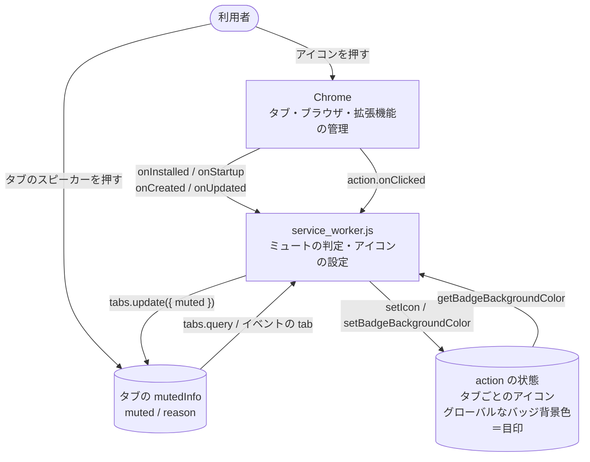

# アーキテクチャ

## 全体像

## 状態をどこに持つか

**拡張機能は状態を保存しない**（CON-03）。必要な情報はすべて Chrome が持っているものから読む。

| 知りたいこと | どこから読むか | 消えるとき |
| --- | --- | --- |
| タブがミュートか | `tab.mutedInfo.muted` | — |
| 利用者がアンミュートしたか | `tab.mutedInfo.reason` の有無（ADR-0001） | タブを閉じたとき |
| 拡張機能を読み込んでから全タブを同期したか | グローバルなバッジ背景色（ADR-0003） | 拡張機能のアンロード（更新・無効化） |
| タブに出すアイコン | タブごとの `setIcon` | ページの遷移（Chrome が消す。SPEC-SW-05） |

Service Worker のグローバル変数には何も持たない。止まると消えるため（CON-01）。

## 契機ごとの動き

| 契機 | Chrome が起こすこと | 拡張機能の動き |
| --- | --- | --- |
| インストール | `onInstalled` | 全タブを強制ミュート、目印を付ける |
| 更新 | 全タブをアンミュート（CON-04）→ `onInstalled` | 同上（ADR-0002） |
| 無効化→再有効化 | 全タブをアンミュート（CON-04）→ Service Worker の起動のみ | 目印が無いので同上（ADR-0003） |
| ブラウザの起動 | `onStartup` | 同上 |
| Service Worker のアイドル停止→再開 | Service Worker の起動のみ | 目印があるので何もしない（NFR-03） |
| 新しいタブ | `onCreated` | ミュートする |
| ページの遷移 | `onUpdated`（`status: 'loading'`） | アンミュートしたタブ以外をミュートし、アイコンを設定し直す |
| アイコンを押す | `action.onClicked` | そのタブのミュートを切り替える |

詳細は [specs/service-worker.md](specs/service-worker.md)。
