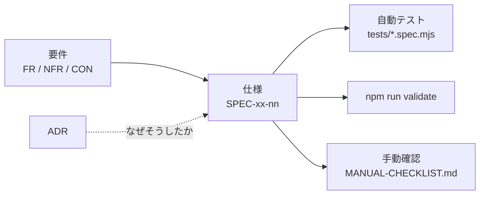

# ドキュメント

## 構成

```text
docs/
├── tasks.md            入口: 残りのタスク
├── requirements.md     入口: 何を作るか → requirements/
├── design.md           入口: どう作るか → ARCHITECTURE.md・specs/・adr/
├── verification.md     入口: 確かめ方と結果 → TESTING.md・TEST-CATALOG.md・MANUAL-CHECKLIST.md
├── requirements/       要件定義 — 「何を満たすべきか」
│   ├── background.md       背景・目的・スコープ
│   ├── functional.md       機能要件 (FR-xx)
│   ├── non-functional.md   非機能要件 (NFR-xx)
│   └── constraints.md      制約条件 (CON-xx)
├── specs/              仕様書 — 「現在どう作られているか」
│   ├── manifest.md         SPEC-MF   拡張機能の宣言
│   ├── service-worker.md   SPEC-SW   ミュートの判定・同期・アイコン
│   └── packaging.md        SPEC-PKG  配布用 zip の作成
├── adr/                設計判断の記録 (ADR-xxxx)
├── ARCHITECTURE.md     全体像・状態をどこに持つか・契機ごとの動き
├── WORKFLOW.md         開発フロー・エージェント・コミットゲート
├── TESTING.md          テストの実行方法・仕組み・自動化できないもの
├── TEST-CATALOG.md     テスト一覧（自動生成）
└── MANUAL-CHECKLIST.md 手動確認チェックリスト
```

## 使い分け

| | 書くもの | 書かないもの |
| --- | --- | --- |
| **requirements/** | 満たすべきこと。実現手段は問わない | 実装方法 |
| **specs/** | **今そうなっている**こと。実装と1対1 | やりたいこと、将来の構想 |
| **adr/** | なぜその作りにしたか。選ばなかった案と理由 | 決まった内容そのもの（それは specs/） |
| **ARCHITECTURE.md** | 全体の見取り図 | 個々の仕様 |

> **仕様書は「あるべき姿」ではなく「実際にそうなっているもの」を書く。**
> 実装と食い違ったら、どちらかが必ずバグ。放置しない。

## 追跡関係



- 仕様には必ず「どの要件を満たすか」と「どう確認するか」を書く
- 要件に紐づかない仕様が出てきたら、要件側の漏れを疑う

## ID の採番

| 接頭辞 | 対象 | 例 |
| --- | --- | --- |
| `FR-` | 機能要件 | `FR-05` |
| `NFR-` | 非機能要件 | `NFR-01` |
| `CON-` | 制約条件 | `CON-04` |
| `SPEC-<領域>-` | 仕様 | `SPEC-SW-04` |
| `ADR-` | 設計判断の記録 | `ADR-0003` |

**既存 ID は再利用しない。** 廃止する場合は項目を残して「廃止」と明記し、欠番にする。

## 担当エージェント

`.claude/agents/` に役割を分けて定義してある。担当ごとの書き換えてよい場所は [WORKFLOW.md](WORKFLOW.md)「エージェント」にある。

> **コミットは、テスト全件が通り、かつ reviewer のレビューが通るまでできない。**
> `.claude/hooks/commit-gate.sh` が機械的に止める。

## 関連

- [AGENTS.md](../AGENTS.md) — 開発ガイド（AI エージェントが最初に読む）
- [README.md](../README.md) / [README.ja.md](../README.ja.md) — 利用者向け
