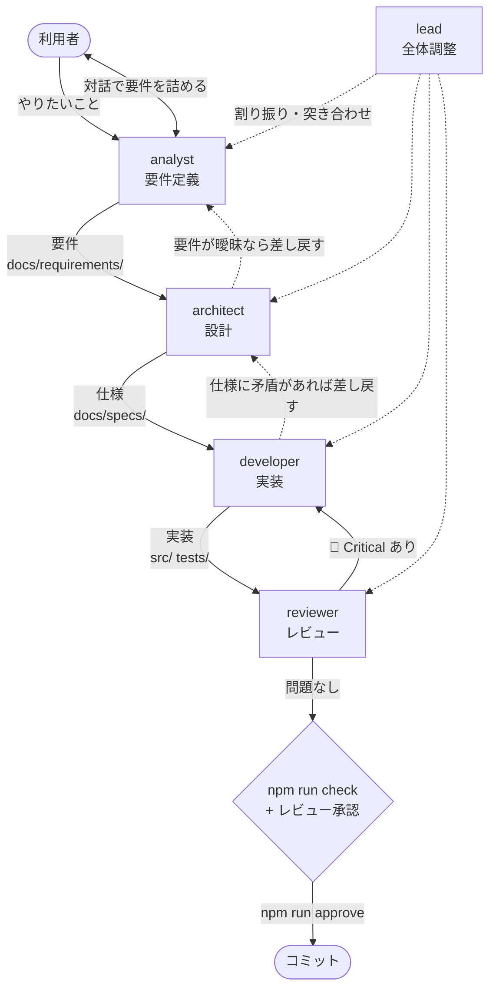
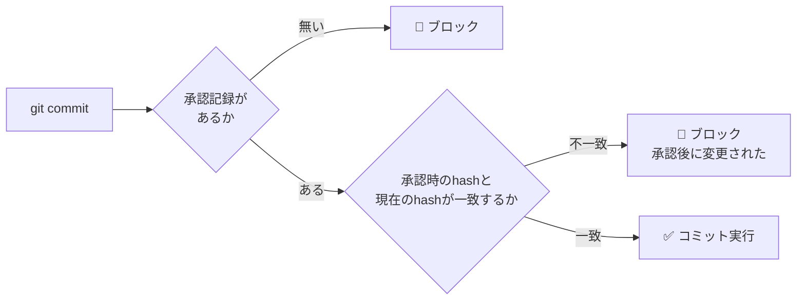

# 開発フロー

要件定義 → 設計 → 実装 → レビュー → コミット の順に、担当を分けたエージェントで進める。
定義は `.claude/agents/` にある。構成は [kabu-tantan](https://github.com/Harurow/chrome.ext.kabu-tantan) に合わせている。

## 全体の流れ



小さな修正（文言・1か所のバグ修正）で全工程を回す必要は無い。**省いてよいのは analyst と architect まで。**
レビューとコミットゲートは省かない。

## エージェント

| エージェント | 役割 | model | 書き換えてよい場所 |
| --- | --- | --- | --- |
| `lead` | 全体調整。工程を回す | opus | なし（自分では作らない） |
| `analyst` | 利用者と対話して要件を決める | opus | `docs/requirements/` |
| `architect` | 要件から設計・仕様を起こす | opus | `docs/requirements/`, `docs/specs/`, `docs/ARCHITECTURE.md`, `docs/adr/`, `docs/README.md` |
| `developer` | 仕様に従って実装する | opus | `src/`, `tests/`, `scripts/`, ルートの設定ファイル, `docs/TESTING.md`, `docs/MANUAL-CHECKLIST.md`, `docs/TEST-CATALOG.md`（生成） |
| `reviewer` | 実装と文書を突き合わせて検証する | opus | **なし（読み取り専用）** |

`AGENTS.md`・`docs/WORKFLOW.md`・`.claude/`・`README.md` / `README.ja.md` はどの担当の書き換え範囲にも入れない。書くのはメインセッション（利用者と直接やり取りしている AI）だけ。

`reviewer` は `tools` に `Write` / `Edit` を持たない。ただし `Bash` は持つので、書き換えをツールの側で完全に防げてはいない（定義で禁じている）。

`analyst` / `architect` / `reviewer` は `effort: high`（掘り下げと網羅性が要るため）。

> コストを下げたい場合、最初に落とす候補は `developer` を `sonnet` にすること。
> `reviewer` は opus のまま残すこと（安全網なので）。

## analyst の対話の制約

**`AskUserQuestion` はサブエージェントからは使えない**（強制的に除去される）。

| 起動方法 | 対話 | 使いどころ |
| --- | --- | --- |
| `claude --agent analyst` | **できる** | 腰を据えて要件を詰めるとき。**推奨** |
| `lead` などから呼び出す | できない | 要件のドラフトと確認事項のリストを返させる |

## 使い方

```bash
claude --agent analyst   # 要件から決める
claude --agent lead      # 工程をまとめて回す
```

単発で使う場合: 仕様だけ整理する → `architect` ／ 仕様が決まっている実装 → `developer` ／ 既存コードの点検 → `reviewer`

## コミットゲート

**すべてのテストが通り、かつレビューが通るまでコミットできない。**
`.claude/hooks/commit-gate.sh`（PreToolUse フック）が機械的に強制する。



### 手順

```bash
# 1. reviewer のレビューを通す（🔴 Critical が無いこと）
# 2. 承認を記録する（npm run check も自動で実行される）
npm run approve "レビュー通過。SPEC-SW-05 の修正"

# 3. コミット（2 とは別の Bash 呼び出しで実行する）
git commit -m "..."
```

> **`npm run approve` と `git commit` を1回の呼び出しにまとめない。**
> フックは呼び出しを実行する前に判定するので、`npm run approve && git commit …` は承認前の状態で判定されて止まる。

### 承認は変更内容に紐づく

`npm run approve` は、現在の作業ツリーのハッシュ（`git diff HEAD` と未追跡ファイルの中身）を
`.claude/review-approved.json` に記録する（`.gitignore` 済み）。
**承認の後にファイルを1文字でも変えると承認は無効になり、コミットが止まる。**

### このゲートが保証すること / しないこと

| | |
| --- | --- |
| ✅ 保証する | `npm run check`（lint + validate + テスト全件 + テストカタログが最新か）が通っていること |
| ✅ 保証する | 承認の後にファイルが変わっていないこと |
| ❌ 保証しない | **`reviewer` に実際に見せたかどうか** |

**レビューを通したかは `lead` とメインセッションの責任。** 工程を飛ばして `approve` しないこと。

### 検出するコマンド

トークン単位で解析し、**コミットを新しく作る**コマンドを検出する。

| 検出する | 通す |
| --- | --- |
| `git commit` / `revert` / `merge` / `cherry-pick` / `rebase` / `am` | `git log --grep="git commit"` |
| `FOO=bar git commit`（環境変数の前置き） | `git commit --dry-run` |
| `git -c user.name=x commit`（グローバルオプション） | `git merge --abort` / `rebase --abort` / `--skip` |
| `cd /tmp && git commit` / `bash -c 'git commit'` | `git status` / `git diff` / `git show` |
| `npm version <引数>`（中で commit しうる。`--no-git-tag-version` を付けても止める） | `npm version`（引数なし。表示するだけ） |

判定できない場合（node が無い、入力の JSON が壊れている、ハッシュを計算できない）は**通さない（fail-closed）**。

> 版を上げるときは `npm version` を使わず、`package.json` と `src/manifest.json` を書き換えてから
> `npm install --package-lock-only` で `package-lock.json` を揃える（`AGENTS.md` の「バージョニング」）。

### 制限

- シェルのエイリアス（`gc` など）経由のコミットは検出できない
- Bash ツールを通らない方法（GUI クライアントなど）も検出できない

## 参照

- エージェント定義: `.claude/agents/`
- フック: `.claude/hooks/commit-gate.sh`（高速パス）, `.claude/hooks/commit-gate.mjs`（解析）, `.claude/settings.json`
- 承認スクリプト: `scripts/approve.mjs`, `scripts/lib/change-hash.mjs`
- ドキュメントの索引: [README.md](README.md)
