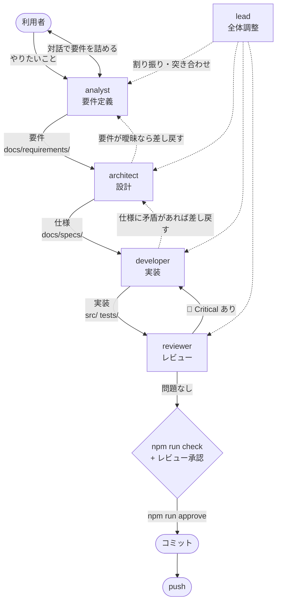
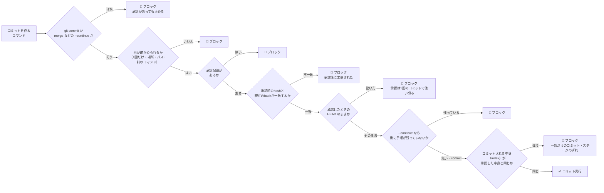

# 開発フロー

要件定義 → 設計 → 実装 → レビュー → コミット → push の順に進める。
工程ごとの担当エージェントの定義は `.claude/agents/` にある（どれを使うかは「サブエージェントに渡す基準」）。構成は [kabu-tantan](https://github.com/Harurow/chrome.ext.kabu-tantan) に合わせている。

## 全体の流れ



担当に渡すかどうかは、変更の大きさではなく下の「サブエージェントに渡す基準」で決める。
渡さずにメインセッションが自分で書くときも、要件・仕様・ADR・テストの文書は、担当が書くときと同じように更新する。
**レビュー（`reviewer`）とコミットゲートは省かない。**

## サブエージェントに渡す基準

メインセッション（利用者と直接やり取りしている AI）は、担当を指定せずに起動したなら、どの場所も自分で書き換えてよい。
`claude --agent <担当>` で起動したときは、その担当の定義に従う。`AGENTS.md`・`docs/WORKFLOW.md`・`.claude/` は書かず、記録すべきことは利用者への報告に書く（`AGENTS.md`「AI エージェント向けの記録」）。
そのとき `lead` 以外の担当は、`reviewer` を呼べないのでコミットもしない。変更を作業ツリーに残し、レビュー・`npm run approve`・コミット・push は担当を指定せずに起動したセッションが続ける。
サブエージェントに渡すのは、次のどれかに当たるときだけにする（利用者の全プロジェクト共通の指示に合わせている）。

| 渡すとき | 例 |
| --- | --- |
| 独立した確認になる | レビュー。**`reviewer` には必ず渡す** |
| 互いに独立した作業を並行させて、時間を縮められる | 仕様の整理と、別の箇所の実装を同時に進める |
| 利用者が工程を回すと決めた | 利用者が `claude --agent lead` / `claude --agent analyst` で起動した |

渡すときは、目的・書き換えてよい場所・完了の条件・読むべき資料（ファイルと ID）・分かっている阻害を伝える。
返ってきた結果はそのまま信じず、自分で確かめてから取り込む。

## エージェント

| エージェント | 役割 | model | 書き換えてよい場所 |
| --- | --- | --- | --- |
| `lead` | 全体調整。工程を回す | opus | なし（自分では作らない） |
| `analyst` | 利用者と対話して要件を決める | opus | `docs/requirements/`, `docs/requirements.md` |
| `architect` | 要件から設計・仕様を起こす | opus | `docs/requirements/`, `docs/requirements.md`, `docs/specs/`, `docs/ARCHITECTURE.md`, `docs/adr/`, `docs/design.md`, `docs/README.md` |
| `developer` | 仕様に従って実装する | opus | `src/`, `tests/`, `scripts/`, ルートの設定ファイル, `docs/TESTING.md`, `docs/MANUAL-CHECKLIST.md`, `docs/TEST-CATALOG.md`（生成）, `docs/verification.md` |
| `reviewer` | 実装と文書を突き合わせて検証する | opus | **なし（読み取り専用）** |

`AGENTS.md`・`docs/WORKFLOW.md`・`docs/tasks.md`・`.claude/`・`README.md` / `README.ja.md` はどの担当の書き換え範囲にも入れない。書くのはメインセッション（利用者と直接やり取りしている AI）だけ。

`reviewer` は `tools` に `Write` / `Edit` を持たない。ただし `Bash` は持つので、書き換えをツールの側で完全に防げてはいない（定義で禁じている）。

`lead` の `tools` にある `Agent(analyst, architect, developer, reviewer)` の種類の制限は、`claude --agent lead` でメインとして動かしたときだけ効く。
サブエージェントとして呼ばれた `lead` では括弧の中が無視され、どの種類のエージェントも呼べる（サブエージェントは既定で、さらにサブエージェントを呼べる。
2026-10-12 に[公式ドキュメント](https://code.claude.com/docs/en/sub-agents)で確認）。

`analyst` / `architect` / `reviewer` は `effort: high`（掘り下げと網羅性が要るため）。

> コストを下げたい場合、最初に落とす候補は `developer` を `sonnet` にすること。
> `reviewer` は opus のまま残すこと（安全網なので）。

## analyst の対話の制約

**`AskUserQuestion` はサブエージェントからは使えない**（強制的に除去される）。

| 起動方法 | 対話 | 使いどころ |
| --- | --- | --- |
| `claude --agent analyst` | **できる** | 腰を据えて要件を詰めるとき。**推奨** |
| `lead` などから呼び出す | できない | 要件のドラフトと確認事項のリストを返させる |

## 使い方

```bash
claude --agent analyst   # 要件から決める
claude --agent lead      # 工程をまとめて回す
```

利用者が `claude --agent` で単発に起動する場合: 仕様だけ整理する → `architect` ／ 仕様が決まっている実装 → `developer` ／ 既存コードの点検 → `reviewer`

## コミットゲート

**すべてのテストが通り、かつレビューが通るまでコミットできない。**
`.claude/hooks/commit-gate.sh`（PreToolUse フック）が機械的に強制する。



### 手順

```bash
# 1. reviewer のレビューを通す（🔴 Critical が無いこと）
# 2. 承認を記録する（npm run check も自動で実行される。途中で作業ツリーが変わったら承認しない）
npm run approve "レビュー通過。SPEC-SW-05 の修正"

# 3. コミット（2 とは別の Bash 呼び出しで実行する。変更はすべて入れる）
git add -A && git commit -m "..."

# 4. push（承認からコミットまでに何も変えていなければ、テストは流し直さない）
git push
```

> **`npm run approve` と `git commit` を1回の呼び出しにまとめない。**
> フックは呼び出しを実行する前に判定するので、`npm run approve && git commit …` は承認前の状態で判定されて止まる。

### 承認は変更内容に紐づく

`npm run approve` は、現在の作業ツリーのハッシュ（変更をすべて、未追跡のファイルも含めてコミットしたときにできる tree の ID。
一時的な index で求めるので、ステージの状態によらず作業ツリーの中身だけで決まる）を
`.claude/review-approved.json` に記録する（`.gitignore` 済み）。
**承認の後にファイルを1文字でも変えると承認は無効になり、コミットが止まる。**

承認は HEAD にも結びつく（承認のファイルの `head`）。ハッシュは作業ツリーの中身なので、コミットしても変わらない。
HEAD も比べることで、**承認は1回のコミットで使い切られ**、そのあとの2回目のコミットは、承認をやり直すまで止まる。

`npm run approve` は、`npm run check` を流す前と後で作業ツリーのハッシュと HEAD を比べ、違えば承認しない（2026-10-15〜）。
チェックの途中で作業ツリーが変わると（ほかのセッションの編集など）、どの状態で通ったか分からないため。
`EXTENSION_PATH` を指定したときも、テストが作業ツリーの `src/` を試さないので承認しない（判定は `scripts/lib/approval.mjs`）。

### コミットされる中身を確かめる

`git commit` のときは、作業ツリーに加えて、**実際にコミットされる中身（index）**も承認した中身と比べる
（2026-10-14 利用者の指示。kabu-tantan で見つかった穴を、こちらにも同じ形で直した）。
作業ツリーだけを比べていたときは、一部だけステージした・ステージしてから作業ツリーを戻した・パスを指定した、
といったコミットで、テストしていない中身が履歴に入りえた。確かめ方は kabu-tantan・love-g-rss-reader のコミットゲートと同じ。

- コミットされる中身は、本物の index の写しで求める（本物の index は触らない）。同じ呼び出しで前に `git add -A` があればそれを足し、
  `git commit -a` なら追跡しているファイルの変更を足す（`-a` は未追跡のファイルを入れないので、未追跡のファイルがあれば止まる）
- パスを指定したコミットや、一部だけのコミット（`-o` / `-i` / `-p` / `--pathspec-from-file`）は止める
- `git commit` の前に置けるのは `git add -A` と、読むだけのコマンド（`git status` / `diff` / `log` / `show` / `rev-parse`、`cd`・`echo`・`cat`・`grep` など）だけ。
  ファイルへ書き出すリダイレクトがあるものも止める（フックは実行の前に判定するので、前で作業ツリーが変わると判定がずれる）
- `set` と、`GIT_` で始まる変数への代入（`GIT_INDEX_FILE=…` など）も、`git commit` の前には置けない（`set -a` のあとの代入は、続く `git commit` の環境に入り、別の index でコミットさせうる。2026-10-15〜）
- 1回の呼び出しで `git commit` を2回以上行うもの、シェル（`bash -c`）やラッパー（`xargs` など。足すパスが見えない）を介した `git commit`、
  `git -C` / `--git-dir` / `--work-tree` / `-c core.worktree=` / `GIT_DIR=` などで場所を変えた `git commit` は止める
- **`git commit` 以外でコミットを作るコマンド（`merge`・`cherry-pick`・`revert`・`rebase`・`am`、その `--skip`、`npm version`）は、承認があっても止める**（2026-10-15 利用者判断）。
  作る中身を前もって承認した中身と比べられないため（承認した変更を含まないマージコミットが作れた）。`--skip` も、残りの手順を続けてコミットを作る
- 途中で止まった `merge` などを続ける `--continue` だけは、`git commit` と同じく index の中身を承認した中身と比べて通す（引数は `--continue` だけ）。
  形は `git add -A && GIT_EDITOR=true git merge --continue`。`merge`・`rebase` の `--continue` はメッセージのエディタを開き、端末の無い Bash では待ったまま止まるか、すぐ失敗する（出力の先による）
  （エディタの設定を外した一時リポジトリで確かめた。`cherry-pick`・`revert`・`am` は開かなかった。`--no-edit` は `--continue` と一緒に書けない。git 2.54）。
  Claude Code の Bash にはもともと `GIT_EDITOR=true` が入っていたが、それに頼らず前置きする。`GIT_EDITOR=true` はコミットを作るセグメント（`git merge --continue`）の前置きなので、前に置くコマンドの `GIT_` の代入の守りには掛からない。
  ただし、今のものの後に手順が残っていれば止める（同じ呼び出しの中で、確かめていないコミットが続けて作られるため）。
  残りは、cherry-pick / revert は `sequencer/todo`、rebase は `rebase-merge/git-rebase-todo`、am と rebase の apply は `rebase-apply/next`・`last` から数える（git 2.54 で確かめた）
- `git pull` はマージやリベースのコミットを作りうるので止める。`--ff-only`（早送りだけ。`--ff` / `--no-ff` とは後に書いた方が勝つ）と `--dry-run` だけ通す。
  置けるオプションは値を取らない決まったもの（`--ff-only`・`--no-rebase`・`-q`・`--prune` など）だけで、ほかがあれば止める
  （`--rebase` / `-r` や、値を取るオプションの値に置いた `--ff-only`（`git pull -o --ff-only`）を通さないため）。`--ff-only` は設定の `pull.rebase` より優先される（git 2.54 で確かめた）
- ヒアドキュメントの中身（コミットメッセージ）はコマンドとして読まない。ただし取り除くのは、引用符の外の `<<` で始まり、
  区切りの直後が行末・空白・演算子で（`<<E"O"F` のような一部だけの引用は読まない）、
  終わりの行が見つかったものだけ（取り除き過ぎると、承認の無い `git commit` を隠して通してしまう）。引用符の中の `<` `>` はリダイレクトとして読まない
- 判定は `.claude/hooks/commit-gate.mjs` と `scripts/lib/change-hash.mjs`、テストは `tests/commit-gate.spec.mjs`
- 形の判定（上の止めるもの）は、承認の有無より先に行う（承認があっても止める形は、その理由を出す）

コミットは上の「手順」のとおり `git add -A && git commit` の形で行う（`npm run approve` とは別の呼び出し）。
メッセージが複数行なら `git add -A && git commit -F - <<'EOF' … EOF` にする（ヒアドキュメントの中身はコマンドとして読まない）。

### このゲートが保証すること / しないこと

| | |
| --- | --- |
| ✅ 保証する | 承認した作業ツリーで `npm run check`（lint + validate + テスト全件 + テストカタログが最新か）が通っていること（流す前と後で作業ツリーと HEAD が同じ） |
| ✅ 保証する | 承認の後にファイルが変わっていないこと |
| ✅ 保証する | `git commit` と `--continue` でコミットされる中身（index）が、承認した作業ツリーの中身と同じこと（一部だけのコミット・ステージのずれを止める。ほかのコミットを作るコマンドは止める。上の「コミットされる中身を確かめる」） |
| ❌ 保証しない | **`reviewer` に実際に見せたかどうか** |

**レビューを通したかは `lead` とメインセッションの責任。** 工程を飛ばして `approve` しないこと。

### 検出するコマンド

トークン単位で解析し、**コミットを新しく作る**コマンドを検出する。

| 検出する | 通す |
| --- | --- |
| `git commit` / `revert` / `merge` / `cherry-pick` / `rebase` / `am` | `git log --grep="git commit"` |
| `FOO=bar git commit`（環境変数の前置き） | `git commit --dry-run` |
| `git -c user.name=x commit`（グローバルオプション） | `git merge --abort` / `rebase --abort` / `--quit` |
| `rebase --skip` / `cherry-pick --skip` / `am --skip`（残りの手順を続ける） | `git pull --ff-only` / `git pull --dry-run` |
| `git pull`（`--ff-only` か `--dry-run` 以外。マージやリベースのコミットを作りうる） | `git fetch` |
| `cd /tmp && git commit` / `bash -c 'git commit'` | `git status` / `git diff` / `git show` |
| `npm version <引数>`（中で commit しうる。`--no-git-tag-version` を付けても止める） | `npm version`（引数なし。表示するだけ） |

検出したものは「コミットされる中身を確かめる」の条件で判定する。通しうるのは `git commit` と `--continue` だけで、ほかは承認があっても止める。

判定できない場合（node が無い、入力の JSON が壊れている、ハッシュを計算できない）は**通さない（fail-closed）**。

> 版を上げるときは `npm version` を使わず、`package.json` と `src/manifest.json` を書き換えてから
> `npm install --package-lock-only` で `package-lock.json` を揃える（`AGENTS.md` の「バージョニング」）。

### 制限

このゲートの目的は、AI がうっかりテストしていない中身をコミットするのを防ぐこと。わざと回り道をするものまでは止めない
（止めようとすると、ふつうのコマンドまで止まる。2026-10-15 利用者判断）。次のものは検出しない。

- シェルのエイリアス（`gc` など）経由のコミット
- git のエイリアス（`git -c alias.ci=commit ci -am x`、`git config alias.*` で作ったもの）
- git の下位のコマンド（plumbing）でコミットを作るもの（`git commit-tree` と `git update-ref`）
- スクリプトのファイルに書いて流すもの（`bash <ファイル>`。ファイルの中身は読まない）
- 環境変数や `--config-env` で git の設定を差し込むもの（`GIT_CONFIG_*` など）
- `git commit` などの、値を取るオプションの値に安全なフラグを置くもの（`git commit --trailer --dry-run -m x` は、`--dry-run` を値と読まずにコミットを作る）
- `git commit` の出力を、追跡しているファイルへ書き出すもの（`git commit -am x > c` は、シェルが c を空にしてから `-a` でコミットする）
- Bash ツールを通らない方法（GUI クライアントなど）

## 参照

- エージェント定義: `.claude/agents/`
- フック: `.claude/hooks/commit-gate.sh`（高速パス）, `.claude/hooks/commit-gate.mjs`（解析）, `.claude/settings.json`
- 承認スクリプト: `scripts/approve.mjs`, `scripts/lib/approval.mjs`, `scripts/lib/change-hash.mjs`
- テスト: `tests/commit-gate.spec.mjs`
- ドキュメントの入口: [tasks.md](tasks.md)・[requirements.md](requirements.md)・[design.md](design.md)・[verification.md](verification.md)
- ドキュメントの索引: [README.md](README.md)
