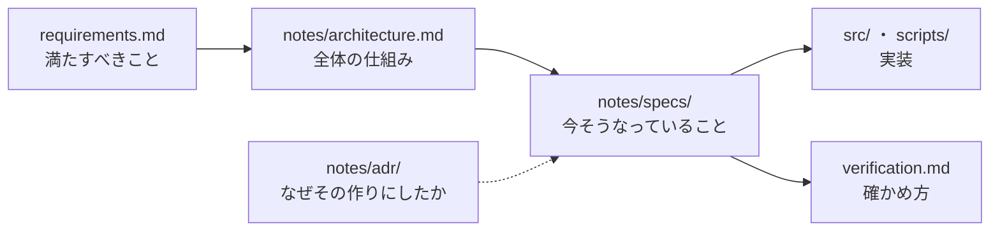
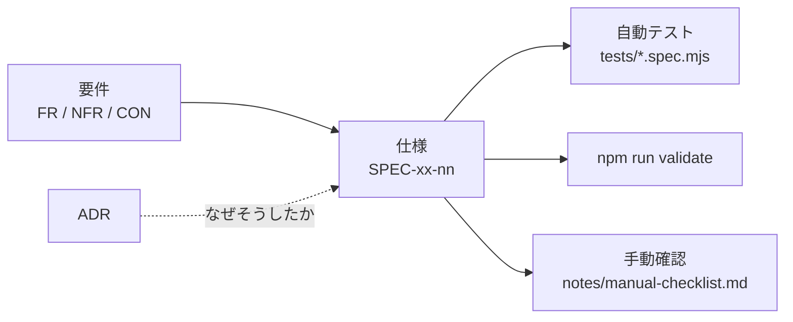

# 設計の入口

## 要約

全体の仕組みは [notes/architecture.md](notes/architecture.md)、実装と1対1の仕様は [notes/specs/](notes/specs/readme.md)、判断の理由は [notes/adr/](notes/adr/readme.md) に置いている。
この入口は案内だけで、設計の中身は書き写さない。

## 全体の図

拡張機能そのものの図（イベントと状態の流れ）は [notes/architecture.md](notes/architecture.md)「全体像」にある。

## 方針

権限を宣言しない（NFR-01）。
状態を自前で持たず、Chrome が持っている状態から読む（CON-03）。
何をどこから読むかは [notes/architecture.md](notes/architecture.md)「状態をどこに持つか」にある。
一見正しい「改善」で壊れる箇所は [AGENTS.md](../AGENTS.md)「変更前に読むこと」にある。
選択肢を比べて決めた理由は [notes/adr/](notes/adr/readme.md) に残している。

## 仕様

仕様（`SPEC-xx`）の一覧と書き方の約束は [notes/specs/readme.md](notes/specs/readme.md) にある。
コミットゲート（承認した中身と同じものしかコミットさせないフック）の仕様は [notes/workflow.md](notes/workflow.md)「コミットゲート」にある。

## タスク

このプロジェクトは `T-n` の番号を使わない。残りのタスクは [tasks.md](tasks.md) にある。
工程（要件 → 設計 → 実装 → レビュー → コミット → push）は [notes/workflow.md](notes/workflow.md) に従う。

## 要件との対応

各仕様に、対応する要件（FR・NFR・CON）と検証方法を必ず書く（[notes/specs/readme.md](notes/specs/readme.md)「記述の約束」）。
要件に紐づかない仕様が出てきたら、要件側の漏れを疑う。

